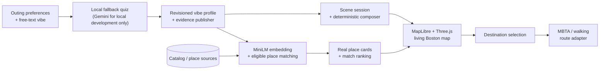

<p align="center">
  
</p>

# VibeWise — discover Boston by how you want to feel

**An interactive Boston discovery experience built for [BostonHacks 2026](https://bostonhacks.org/), in the Bos(tons) of Eats and Streets track.**

Instead of starting with a restaurant name, VibeWise starts with a feeling. Describe the atmosphere you want, refine it through an adaptive, media-rich quiz, and explore matching real places on a stylized 3D Boston map. The map's atmosphere changes with the evolving vibe, and supported destinations connect to MBTA route planning.

**[Try the deployed app](https://vibewise-bostonhacks.vercel.app/)** · **[Explore the engineering](docs/PORTFOLIO_ENGINEERING.md)** · **[View the hackathon snapshot](docs/HACKATHON_SNAPSHOT.md)**

> **Public-demo safety:** The hosted site never uses a shared Gemini API key. Quiz questions run through the existing local fallback so visitors can explore the project without incurring charges for the team. Gemini-assisted questions remain part of the original hackathon implementation and can be enabled **only in private local development with your own key**. Venue ranking, accounts, and routing independently depend on their service configuration and data availability. [Security and setup details](docs/PUBLIC_DEMO_SECURITY.md).

## The experience

1. **Set the outing.** Pick food or activities, budget, timing, and a Boston starting point.
2. **Describe the vibe.** Give a free-text prompt; the quiz uses text, imagery, and optional listening-based question formats to refine your preferences.
3. **Watch the city respond.** The map updates its lighting, color, materials, and stylized scene elements as the preference profile changes.
4. **Find a place.** Browse real Boston places and, when the compatible catalog is available, rank eligible destinations by semantic fit.
5. **Get there.** Select a destination and inspect supported MBTA/walking directions, with explicit limitations when a journey cannot be established.

The strongest feature is the **coupling between an evolving preference model and a living, navigable map**—the visual transformation is part of the discovery interaction, not a static theme switch.

## What we built

| System | Hackathon implementation |
| --- | --- |
| **Adaptive vibe discovery** | The hackathon implementation used server-side Gemini generation with a bounded local fallback; the **public deployment uses fallback only**. Session history, corrections, evidence, and the ten-question cap remain implemented. |
| **Semantic matching** | A shared MiniLM text-embedding pipeline, compatible catalog-vector checks, and reversible result/rank presentation. Real semantic venue ranking requires the configured catalog; labeled fixture tests are not live venue results. |
| **Living 3D Boston map** | MapLibre-based navigation with a scene/compiler pipeline, Three.js appearance and atmosphere rendering, themed materials/decorations, and transitions that retain geographic context. |
| **Real-place exploration** | Place categories, search, filters, selected-place cards, saved locations, and location-aware discovery. External place data and enrichment are identified separately from illustrative scene effects. |
| **MBTA navigation** | Provider-backed transit data, itinerary and route overlays for supported cases, and explicit no-route/error handling rather than fabricated journeys. |
| **Custom visual identity** | VibeWise V3 “Layered Sheets”: original wordmarks, iconography, sheet geometry, typography, and responsive panel/map presentation. |

**Not represented as finished functionality:** group vibe reconciliation, image-based Recreate Mode, Student Pulse, and comprehensive verified student discount coverage. These belong to the [longer-term product vision](PRODUCT_VISION.md), not to the demonstrated hackathon scope.

## System overview



The scene is **artistic**, not a claim about real weather, architecture, lighting, or venue conditions. Real geographic positions, venue identifiers, and transit responses remain separate from the visual effects.

## Technology

**TypeScript · Vite · MapLibre GL · Three.js · Gemini · MiniLM / Transformers.js · Supabase (Postgres/pgvector) · Node.js / Express · MBTA V3 API**

The codebase has three main areas:

- [`apps/web/`](apps/web/) — browser experience, map/scene engines, vibe session, UI, and server API.
- [`pipeline/`](pipeline/) — optional offline place-data ingestion and enrichment.
- [`supabase/migrations/`](supabase/migrations/) — catalog, account, and supporting database schema.

For module-level architecture, design constraints, test evidence, and known limitations, see the **[engineering walkthrough](docs/PORTFOLIO_ENGINEERING.md)**.

## Run locally

Use **Node.js 24** and npm. From the repository root:

```bash
cp .env.example .env
cp apps/web/.env.example apps/web/.env
cd apps/web
npm install
npm run dev:all
```

The local Vite app uses port **5173** by default; the API server uses port **8787** by default. A browser-only start is available with `npm run dev`. Both local environment files are ignored by Git. The root `.env` holds optional server-only credentials; `apps/web/.env` holds browser-safe Vite configuration.

For the full external-service experience, configure MBTA and Supabase according to [`.env.example`](.env.example) and [`apps/web/.env.example`](apps/web/.env.example). **Public deployments cannot use a server-owned Gemini key, even if one remains configured in the hosting environment.** To try Gemini-assisted quiz generation, run the app **locally** with a key from your own Google project and set `VIBE_ENABLE_LOCAL_GEMINI=true` in the root ignored `.env`. Do not set this flag on a hosted service. See [Public-demo security](docs/PUBLIC_DEMO_SECURITY.md) and [historical deployment notes](https://github.com/Dold18/vibewise_bostonhacks/blob/archive/bostonhacks-2026-final-20261122/README.md#deploying-to-vercel). **Never put secret keys in `VITE_` variables or commit `.env` files.** The data-enrichment pipeline has additional configuration and schema requirements; it is not necessary merely to inspect the UI.

### Build and tests

```bash
cd apps/web
npm test
npm run build
```

The [November 22 V3 integration QA report](docs/v3-production-integration.md) records a successful TypeScript check, production build, and **1,118 passing Vitest tests** in the integration environment. The report also documents incomplete or environment-dependent browser checks. Those are historical results; this README update does not claim a fresh test run or verification of the currently hosted deployment.

## Team project and contribution boundaries

VibeWise was built **collaboratively at BostonHacks 2026**. Jacob Dold focused on the AI/vibe and cross-workstream integration effort, alongside teammates contributing map, transit, UI, and other product systems. See [GitHub's pull-request and commit history](https://github.com/Dold18/vibewise_bostonhacks/pulls?q=is%3Apr+is%3Aclosed) for implementation history and attribution. This portfolio repository is **not presented as a solo-authored application**.

The archive includes team planning notes and design proposals. Those documents are useful historical context but should not be interpreted as proof that every proposed feature shipped.

## Data, licensing, and limitations

- Real Boston locations and MBTA information are distinguished from generated or stylized map scenery. Service availability, schedule coverage, pricing, and recommendation completeness are not guaranteed.
- Some functionality requires independently configured credentials, external APIs, and enriched catalog data. Missing data is surfaced rather than silently fabricated.
- Third-party models, images, fonts, scene assets, and map data have separate licenses/attribution requirements preserved in their respective source directories. **No blanket license to reuse the full repository is asserted here.**
- The original post-hackathon code state is preserved at [`archive/bostonhacks-2026-final-20261122`](https://github.com/Dold18/vibewise_bostonhacks/tree/archive/bostonhacks-2026-final-20261122). [Snapshot details](docs/HACKATHON_SNAPSHOT.md).

---

*Built at BostonHacks 2026 · Bos(tons) of Eats and Streets*
